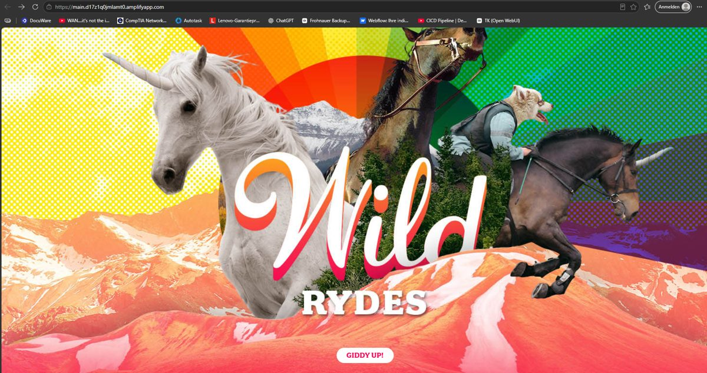
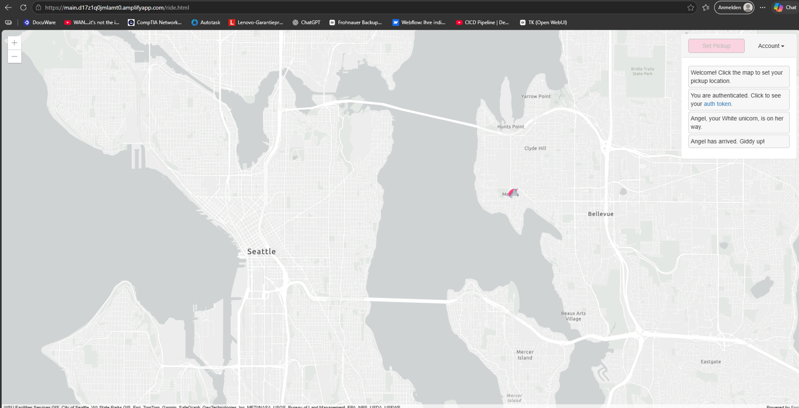
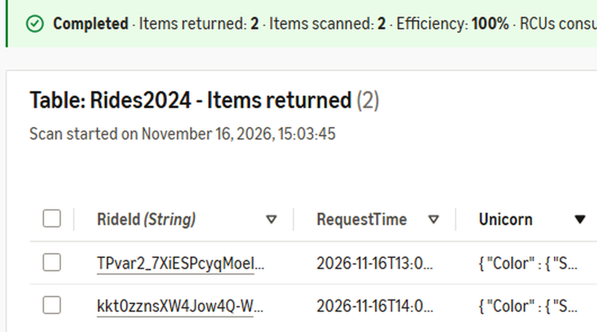
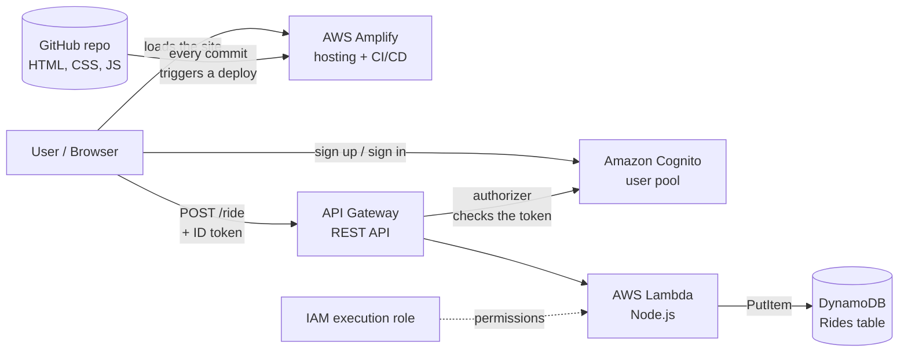

# Wild Rydes: a serverless unicorn ride-sharing app on AWS

"Uber for unicorns". A full-stack serverless web application built **by hand in the AWS Console**: users register and log in, click a spot on a map to request a unicorn, and the ride is saved in a database.

> The web app is the official AWS **Wild Rydes** sample project, and the build follows a YouTube tutorial by **Tiny Technical Tutorials**. My contribution: rebuilding it from scratch in `eu-central-1` with the newer AWS console, the full written guide, the problems I hit and how I fixed them, and the clean-up notes. See [Credits](#credits).

| Landing page | Requesting a unicorn |
|---|---|
|  |  |

The rides are stored in DynamoDB:



## Architecture



| Service | Role in the project |
|---|---|
| **GitHub** | Source control for the site (HTML, CSS, JavaScript) |
| **Amplify** | Hosts the site and redeploys automatically on every commit |
| **Cognito** | User registration, email verification and login |
| **API Gateway (REST)** | Public `POST /ride` endpoint, protected by a Cognito authorizer, with CORS |
| **Lambda** | Picks a unicorn and records the ride |
| **DynamoDB** | Stores the rides (`RideId` is the partition key) |
| **IAM** | Execution role that lets the Lambda write to this one table |

Region used: `eu-central-1` (Frankfurt).

## How a ride works

1. The user registers (Cognito emails a verification code) and signs in.
2. The browser gets an **ID token** from Cognito.
3. Clicking the map sends `POST /ride` with the pickup location, and the token in the `Authorization` header.
4. API Gateway lets the **Cognito authorizer** validate the token. A bad or expired token returns `401`.
5. The Lambda picks a unicorn, writes the ride to DynamoDB and returns the unicorn's details.
6. The page shows "your unicorn is on the way", then "has arrived".

## Repository layout

```
wildrydes-site/
├── css/ fonts/ images/ js/        # Original Wild Rydes site (from the template)
│   └── js/config.js               # The only file I edit: Cognito IDs + API URL
├── *.html                         # Landing, register, verify, sign-in and ride pages
├── docs/                          # Screenshots used in this README
├── PROJECT_GUIDE.md               # Full step-by-step guide + problems I hit
├── README-template.md             # Original template README (has the Lambda code and test event)
└── README.md                      # This file
```

The Lambda function code and the test event are in `README-template.md`, as in the original template.

## What I learned

- **User pools and identity pools are different services.** Registration and login need a *user pool*. The Cognito start page can lead you to *identity pools* by mistake.
- The app logs in from the browser with **SRP**, so the app client needs `ALLOW_USER_SRP_AUTH` turned on.
- **Names must match exactly** across the Lambda code, the IAM policy and DynamoDB (table name, key name, case included).
- API Gateway needs **CORS** (the site and the API are on different domains) and a **Deploy** after every change.
- Tokens **expire after 60 minutes**. A `401` while testing is often just an old token.
- Everything in the console can be cleaned up in a fixed order, so nothing keeps costing money.

## Clean-up

Everything was deleted after testing: Amplify app, API Gateway API, Lambda, DynamoDB table, Cognito user pool, IAM role, and the CloudWatch log group. Order and details are in the guide.

## Possible next steps

- Rebuild the same stack with **Terraform** and a CI/CD pipeline, like my other projects
- Add more unicorns, or look up a nearby one instead of picking randomly
- Restrict CORS to the real site domain and add throttling to the API

## Credits

- **Wild Rydes** sample application by AWS (web app and Lambda logic)
- Tutorial video by **Tiny Technical Tutorials** on YouTube, and the template repository `tinytechnicaltutorials/wildrydes-site`
- Guide, troubleshooting notes and documentation: my own write-up
